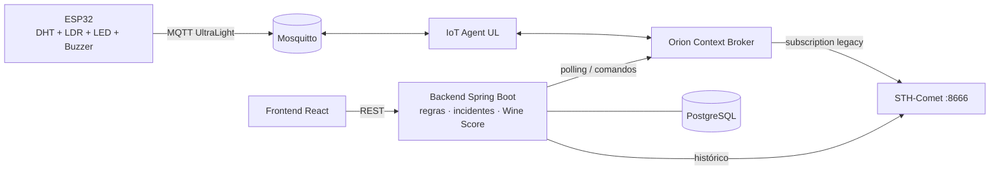

# 🍷 WineGuard — Cellar Intelligence

> Monitoramento inteligente de ambientes de armazenamento de vinhos com ESP32, FIWARE e STH-Comet.
> Projeto **CP5 — Vinheria Full** (Edge Computing & Computer Systems).
> Simulação no Wokwi: https://wokwi.com/projects/477186077844256769

   

---

## O problema

Vinho é um produto vivo. **Temperatura** acima de ~18 °C acelera a oxidação; **oscilações** fazem a rolha "respirar"; **umidade** baixa resseca a rolha e alta gera mofo; **luz** degrada compostos aromáticos ("gosto de luz"). Em uma vinheria com várias áreas (adegas, estoque, sala de degustação), uma porta aberta ou um ar-condicionado parado podem comprometer milhares de reais em garrafas — e normalmente ninguém percebe a tempo.

## A solução

O WineGuard mede continuamente cada área com um ESP32, envia os dados à plataforma **FIWARE**, guarda o histórico no **STH-Comet** e entrega um **dashboard profissional** que:

- detecta anomalias com **triggers configuráveis** e tempo para disparo;
- abre **um único incidente** por anomalia, classifica em 🟢 Normal · 🟡 Atenção · 🟠 Crítico · 🔴 Emergência e encerra sozinho quando o ambiente normaliza;
- **aciona remotamente o ESP32**: LED azul piscando enquanto a condição persistir e **padrão sonoro diferente** para temperatura, umidade e luminosidade;
- resume a qualidade do ambiente no **Wine Score (0–100)**;
- mostra o **mapa da vinheria** colorido por estado e detecta **dispositivos offline** pelo heartbeat.

## Diferenciais

| | |
|---|---|
| 🧠 **WineGuard Intelligence** | índice de risco de conservação 0–100 por ambiente, explicável: mostra quais variáveis pesaram, há quanto tempo, e recomenda a ação (climatização, umidade, luz). Usa só os limites configurados e marca dados ausentes/antigos como "indeterminado" ([especificação](docs/intelligence.md)) |
| 🍇 **Wine Score** | índice 0–100 por área e geral, considerando valores atuais, tempo fora da faixa e ocorrências das últimas 24h, com detalhamento de cada penalidade ([especificação](docs/wine-score.md)) |
| 🗺️ **Mapa da vinheria** | planta com Adega Premium, Adega Reserva, Estoque e Sala de Degustação; cada área muda de cor (verde/amarelo/vermelho/cinza) e abre o dispositivo ao clicar |
| 🚨 **Central de incidentes** | tipo, dispositivo, local, valor detectado/pico, limite, início, normalização, duração ao vivo, severidade, status e "Silenciar" |
| 🎚️ **Triggers configuráveis** | mín/máx e tempo para disparo por variável, faixas de severidade, escalonamento por tempo, LED/buzzer liga/desliga — persistidos no PostgreSQL |
| 💓 **Detecção offline** | 🟢 Online · 🟡 Instável · 🔴 Alerta · ⚫ Offline, com último contato e tempo offline |
| 📡 **Alertas remotos** | Frontend → Backend → Orion → IoT Agent → MQTT → ESP32, com confirmação do estado real dos atuadores e reenvio automático |
| ▶️ **Modo Demo** | roteiro de 11 passos para o hands-on, cada passo confirmado pelo estado real do sistema |

## Arquitetura



| Camada | Responsável por |
|---|---|
| **Frontend** | interface, gráficos, cadastro, triggers, incidentes, mapa, Modo Demo |
| **Backend** | regras de negócio, triggers, Wine Score, dispositivos, incidentes, comunicação FIWARE, comandos remotos |
| **Infraestrutura** | FIWARE Orion, IoT Agent, STH-Comet, Mosquitto, MongoDB, PostgreSQL |
| **Hardware** | leitura dos sensores, comunicação, buzzer, LED, execução dos comandos |

Detalhes, decisões e a **análise dos 16 problemas de integração** ESP32 ⇄ FIWARE ⇄ STH ⇄ backend ⇄ frontend: [docs/architecture.md](docs/architecture.md).

## Tecnologias

| Camada | Stack |
|---|---|
| Frontend | React 19, Vite, TypeScript, Tailwind CSS 4, Recharts, Lucide Icons, TanStack Query, React Router |
| Backend | Java 21, Spring Boot 3.5, Maven, Spring Data JPA, Bean Validation, Spring Actuator, springdoc (Swagger), Eclipse Paho MQTT |
| Banco | PostgreSQL 16 (H2 opcional para desenvolvimento) |
| IoT | ESP32, Arduino framework, DHT11/DHT22, LDR, PubSubClient |
| Infra | FIWARE Orion 3.10, IoT Agent UltraLight 3.4, STH-Comet 2.10, Mosquitto 2, MongoDB 4.4, Docker Compose |

## Funcionamento

1. O ESP32 publica a cada 5s `t|13.4|h|66|l|4|a|none|k|off|d|off|u|1234` em `/TEF/wg001/attrs`.
2. O IoT Agent atualiza a entidade `urn:ngsi-ld:WineSensor:wg001` no Orion; o Orion notifica o STH-Comet.
3. O backend lê o Orion a cada 2s e, para cada dispositivo: atualiza heartbeat → avalia triggers → abre/atualiza/encerra incidentes → recalcula o Wine Score → reconcilia LED e buzzer.
4. Em uma anomalia, o backend envia `ledOn` e `alertTemp` ao Orion; o IoT Agent publica em `/TEF/wg001/cmd`; o ESP32 executa, confirma em `/cmdexe` e passa a reportar `a|temp k|on`.
5. Quando o valor volta à faixa (e permanece por `clearSeconds`), o incidente é encerrado, `alertStop|all` e `ledOff` são enviados e o horário de normalização é registrado.
6. O frontend consome `/api/*` (dashboard a cada 2,5s) e o histórico via backend → STH-Comet `:8666`.

## Instalação e execução

```bash
cp .env.example .env                              # defina POSTGRES_PASSWORD
docker compose --profile fiware up -d --build     # FIWARE + PostgreSQL + backend + frontend
```

- Dashboard: **http://localhost:5173**
- API/Swagger: http://localhost:8080/swagger-ui.html

**FIWARE na AWS (EC2) — modo usado na entrega:** o FIWARE do professor ([fabiocabrini/fiware](https://github.com/fabiocabrini/fiware)) roda na EC2 e só a aplicação roda no notebook:

```bash
# no .env: FIWARE_ORION_URL, FIWARE_IOTA_URL, FIWARE_STH_URL e MQTT_BROKER_URL apontando para o IP (ou nome DNS) da EC2
docker compose up -d --build                      # PostgreSQL + backend + frontend (sem o perfil fiware)
```

O IP público da EC2 muda a cada stop/start: atualize o `.env`, o `config.h` do ESP32 e o `config.wokwi.h`. Em redes que filtram acesso por IP (ex.: FIAP-IOT), use o nome DNS `ec2-<ip>.compute-1.amazonaws.com`.

Outras formas (FIWARE em VM remota, desenvolvimento local, modo standalone sem FIWARE): [docs/installation.md](docs/installation.md).

## Configuração

| O quê | Onde |
|---|---|
| URLs FIWARE, tenant, apikey, MQTT, banco | `.env` ([.env.example](.env.example)) — `FIWARE_ORION_URL`, `FIWARE_STH_URL`, `FIWARE_IOTA_URL`, `DATABASE_URL`, … ([docs/fiware.md](docs/fiware.md), [docs/backend.md](docs/backend.md)) |
| Triggers, severidades, LED/buzzer, heartbeat | tela **Configuração** do dashboard (persistido no banco) |
| Wi-Fi, broker, `DEVICE_ID`, DHT11/DHT22, pinos, calibração do LDR | `firmware/WineGuard/config.h` ([docs/esp32.md](docs/esp32.md)) |
| Frontend | `VITE_BACKEND_URL` / `VITE_API_URL` ([docs/frontend.md](docs/frontend.md)) |

Nenhuma senha, token ou URL sensível está no código — `.env` e `config.h` são ignorados pelo git.

## Wokwi

Simulação em [`wokwi/`](wokwi): ESP32 + **DHT22** + fotoresistor + buzzer + LED azul. O `sketch.ino` é gerado a partir do firmware real (`node firmware/tools/build-wokwi.mjs`), então a única diferença para o hardware físico é `#define WG_DHT_TYPE DHT22` → `DHT11`.

| ESP32 | Componente |
|---|---|
| GPIO 15 | DHT22/DHT11 (dados) |
| GPIO 34 | LDR (AO) |
| GPIO 18 | Buzzer |
| GPIO 2 | LED azul (+ resistor 220 Ω) |
| GPIO 21 / GPIO 22 | LCD 16x2 I2C — SDA / SCL (fora da protoboard; VCC no VIN, endereço `LCD_ADDR`) |

**Simulação no Wokwi:** https://wokwi.com/projects/477186077844256769

## Endpoints principais

| Método | Endpoint | Descrição |
|---|---|---|
| GET | `/api/dashboard` | visão geral completa |
| GET/POST/PUT/DELETE | `/api/devices[/{id}]` | CRUD de dispositivos (provisiona no IoT Agent) |
| PATCH | `/api/devices/{id}/status` | ativar/desativar |
| POST | `/api/devices/{id}/commands` | `ledOn`, `ledOff`, `alertTemp`, `alertHum`, `alertLux`, `alertStop`, `demo` |
| GET | `/api/devices/{id}/history?variable=&period=` | histórico STH-Comet (1h, 6h, 24h, 7d, 30d) + limites |
| GET | `/api/incidents` · POST `/api/incidents/{id}/acknowledge` | central de incidentes |
| GET/PUT | `/api/config/environment` | configuração do ambiente |
| GET/POST | `/api/demo`, `/api/demo/start`, `/recover`, `/stop` | Modo Demo |
| GET | `/api/system/status` | saúde do FIWARE |

Lista completa: [docs/backend.md](docs/backend.md) · Requisições FIWARE: [docs/fiware-requests.http](docs/fiware-requests.http)

## Estrutura de pastas

```
wineguard/
├── backend/            Spring Boot (regras, incidentes, Wine Score, integração FIWARE)
├── frontend/           React + Vite + Tailwind (dashboard)
├── firmware/
│   ├── WineGuard/      firmware ESP32 (Arduino)
│   └── tools/          build-wokwi.mjs
├── wokwi/              diagram.json, sketch.ino (gerado), libraries.txt
├── infra/mosquitto/    configuração do broker
├── docs/               arquitetura, instalação, FIWARE, backend, frontend, ESP32, operação, troubleshooting
├── docker-compose.yml
└── .env.example
```

## Manual de operação

Rotina do operador, cadastro de dispositivos, configuração de triggers e o **roteiro do hands-on** com o Modo Demo: [docs/operation-manual.md](docs/operation-manual.md). Problemas comuns: [docs/troubleshooting.md](docs/troubleshooting.md).

## Testes

```bash
cd backend && mvn test     # 38 testes: triggers, Wine Score, WineGuard Intelligence, alertas manuais, UltraLight, STH e fluxo completo
cd frontend && npm run build

# sem Maven instalado:
docker run --rm -v "$PWD/backend:/app" -w /app maven:3.9-eclipse-temurin-21 mvn -B test
```

O teste `StandaloneFlowIntegrationTest` percorre o ciclo inteiro: leitura normal → anomalia → incidente único → LED + buzzer reportados pelo dispositivo → normalização → incidente encerrado.

## Evidências

Resultados registrados durante o desenvolvimento (substitua/complete com prints e vídeo):

| Data | Verificação | Resultado |
| --- | --- | --- |
| 25/10 | `mvn test` (backend) | 38 testes, 0 falhas |
| 25/10 | Build do frontend (`tsc` + `vite build`) | OK |
| 25/10 | Compilação do firmware (ESP32, core 3.3.11) | OK, 72% da flash (com LCD) |
| 25/10 | Comando manual `alertTemp` (dispositivo virtual) | alerta mantido por 74 s sem ser desfeito (antes: ~5 s) |
| 25/10 | Modo Demo (dispositivo virtual) | concluído em 63 s; incidente aberto e resolvido |
| 25/10 | Wokwi → FIWARE na EC2 | medições no Orion; LCD exibindo valores (verificação visual) |
| 22/10 | ESP32 físico (DHT11, LDR, buzzer, LED) → FIWARE na EC2 | medições no Orion e STH; alertas automáticos e normalização confirmados |

> Adicione aqui prints/vídeo do dashboard, do Modo Demo, do ESP32 com LED/buzzer, do Wokwi e das respostas do Orion/STH-Comet.

| Evidência | Arquivo |
|---|---|
| Dashboard — visão geral | `docs/evidencias/dashboard.png` |
| Modo Demo concluído (11/11) | `docs/evidencias/demo.png` |
| Central de incidentes | `docs/evidencias/incidentes.png` |
| Gráfico histórico (STH-Comet) | `docs/evidencias/historico.png` |
| ESP32 físico / Wokwi | `docs/evidencias/esp32.jpg` |

## Segurança e limitações conhecidas

- O MQTT do FIWARE aceita conexão anônima e Orion/IoT Agent não têm autenticação (configuração do FIWARE Descomplicado, adequada só para demonstração). No Security Group, libere 1026/4041/8666 apenas para o seu IP; a 1883 precisa ficar aberta para o Wokwi e o ESP32. Não exponha a 27017 (MongoDB).
- PostgreSQL publicado só em `127.0.0.1`. `.env`, `firmware/WineGuard/config.h` e sketches gerados com Wi-Fi ficam fora do git.
- A configuração de triggers é única para todos os ambientes.
- LCD validado no Wokwi; teste no hardware físico pendente (ver [docs/esp32.md](docs/esp32.md)).
- `requirements.txt`: o projeto não tem código Python; o arquivo explica onde estão as dependências reais.

## Integrantes

| Nome | RM |
|---|---|
| Thiago Souza de Lima | 568732 |
| Matheus Akira Aso | 572830 |
| João Vitor | 571389 |
| Kelvyn Lukas | 572950 |
| Nicolas Cinel Moreira | 572940 |
| Luis Fernando | 570959 |
