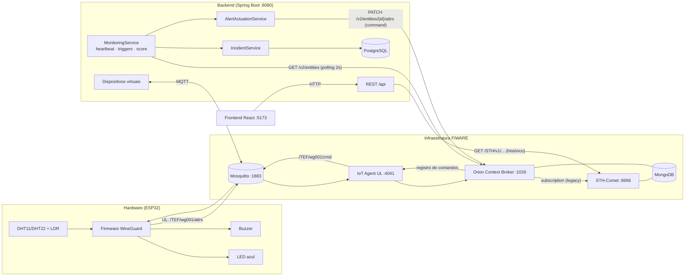
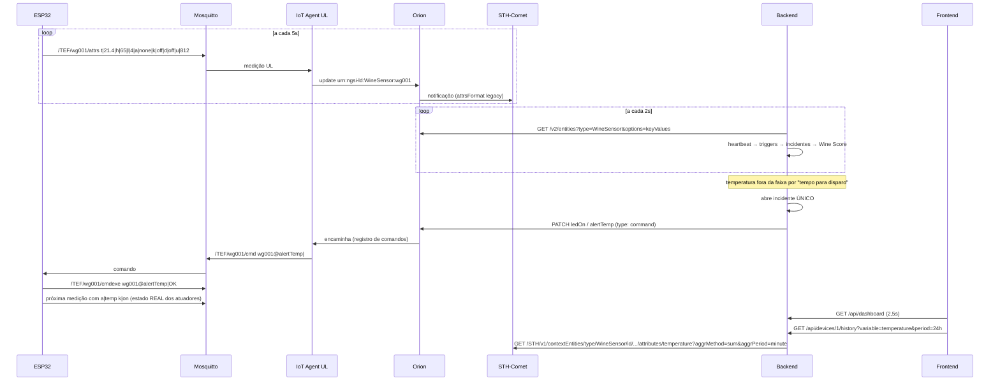

# Arquitetura do WineGuard

## Visão em camadas



| Camada | Responsabilidades | Onde |
|---|---|---|
| **Frontend** | Interface, gráficos, cadastro, triggers, incidentes, mapa, Modo Demo | `frontend/` |
| **Backend** | Regras de negócio, triggers, Wine Score, dispositivos, incidentes, comandos, integração FIWARE | `backend/` |
| **Infraestrutura** | Orion, IoT Agent, STH-Comet, Mosquitto, MongoDB, PostgreSQL, HTTP | `docker-compose.yml`, `infra/` |
| **Hardware** | Leitura dos sensores, comunicação MQTT, buzzer, LED, execução de comandos | `firmware/`, `wokwi/` |

## Organização do backend

```
com.wineguard
├── config/          propriedades tipadas, CORS, RestClients, seed, scheduling
├── domain/          enums do domínio (Zone, Variable, AlertLevel, DeviceCommand…)
├── entity/          entidades JPA (Device, Incident, EnvironmentConfig, EventLog)
├── repository/      Spring Data JPA
├── dto/             contratos da API (records + Bean Validation)
├── rules/           regras PURAS e testadas: TriggerRules, WineScoreCalculator
├── monitoring/      ciclo de monitoramento, heartbeat, máquina de estados dos triggers, atuação
├── service/         casos de uso (dispositivos, incidentes, histórico, dashboard, comandos…)
├── demo/            orquestração do Modo Demo
├── telemetry/       portas (interfaces) TelemetrySource, HistorySource, CommandGateway, DeviceProvisioner
├── integration/
│   ├── fiware/      adaptadores Orion, IoT Agent, STH-Comet
│   └── standalone/  adaptadores em memória (rodar sem FIWARE)
├── simulation/      dispositivos virtuais (gêmeos de software do firmware)
├── exception/       exceções + handler RFC 7807
└── web/             controllers REST
```

As regras de negócio dependem apenas das **interfaces** em `telemetry/`. O modo (`WINEGUARD_MODE=fiware|standalone`) escolhe os adaptadores — nenhuma regra muda.

## Fluxo de dados



## Contrato de atributos (firmware ⇄ IoT Agent ⇄ Orion ⇄ STH)

| UL | Atributo NGSI | Tipo | Significado |
|---|---|---|---|
| `t` | `temperature` | Number | °C |
| `h` | `humidity` | Number | % UR |
| `l` | `luminosity` | Number | 0–100 % (LDR calibrado) |
| `a` | `alertState` | Text | alertas sonoros ativos: `none` ou `temp,hum,lux` |
| `k` | `ledState` | Text | `on`/`off` (LED piscando) |
| `d` | `demoMode` | Text | `off` ou `temp:+8` |
| `u` | `uptime` | Number | segundos desde o boot — muda a cada envio |

Comandos provisionados: `ledOn`, `ledOff`, `alertTemp`, `alertHum`, `alertLux`, `alertStop` (param `temp|hum|lux|all`), `demo` (param `temp:+9` / `off`).

## Análise de problemas de integração (e como foram resolvidos)

| # | Problema | Consequência se ignorado | Solução no WineGuard |
|---|---|---|---|
| 1 | **Headers `fiware-service`/`fiware-servicepath` divergentes** entre IoT Agent, Orion e STH | Dados "somem": entidade existe em um tenant e é consultada em outro | Um único par configurável (`FIWARE_SERVICE`, `FIWARE_SERVICE_PATH`) aplicado a todos os `RestClient` |
| 2 | **STH-Comet só aceita notificações NGSIv1** | Subscription criada sem efeito, histórico vazio | Subscription com `attrsFormat: "legacy"` criada automaticamente |
| 3 | **Orion só notifica quando a entidade muda** — valor estável = sem histórico e heartbeat "parado" | Gráficos com buracos; dispositivo saudável marcado offline | Firmware envia `uptime` (muda sempre); subscription sem `condition.attrs` |
| 4 | **Números como string** sem `IOTA_AUTOCAST` | Agregações do STH vazias, parsing falho | `IOTA_AUTOCAST=true` no compose; backend aceita número ou string; fallback para dados raw |
| 5 | **Paginação do STH** (máx. 100 valores por página por padrão) | Gráfico de 1h truncado | Paginação `hLimit/hOffset` para raw; agregação por minuto/hora para 6h–30d; *downsampling* para ≤ 360 pontos |
| 6 | **Clock skew** entre VM FIWARE e backend | Dispositivos "offline" ou "online" incorretamente | "Último contato" usa o relógio do backend quando o conteúdo da entidade muda |
| 7 | **Orion fora do ar** | Todos os dispositivos marcados offline e dezenas de incidentes falsos | Falha da fonte NÃO altera conectividade; evento único de sistema; barra de saúde no frontend |
| 8 | **Orion não alcança o backend** (notebook atrás de NAT + VM na nuvem) | Subscription Orion→backend nunca chega | Backend usa **polling** do Orion (não depende de rota de entrada) |
| 9 | **URLs internas vs externas** (o IoT Agent fala com o Orion pela rede Docker; o backend pelo IP público) | Provisionamento com `cbroker` inalcançável | Variáveis separadas: `FIWARE_IOTA_CBROKER_URL` e `FIWARE_STH_NOTIFY_URL` |
| 10 | **Comando perdido / ESP32 reiniciou** | LED apagado com anomalia ativa (ou buzzer eterno) | Firmware reporta `alertState`/`ledState`; backend reenvia se divergir por > 20s |
| 11 | **Tópicos MQTT de comando** mudaram (`/ul/` prefix) em versões novas do IoT Agent | ESP32 não recebe comandos | Firmware e simulador assinam `/{apikey}/{id}/cmd` **e** `/ul/{apikey}/{id}/cmd` |
| 12 | **Alertas repetidos** a cada leitura | Spam de incidentes/comandos | Máquina de estados: incidente único por (dispositivo, variável); comandos só na mudança de estado |
| 13 | **Flapping** perto do limite | Abre/fecha incidente sem parar | "Tempo para disparo" + "normal por N s" antes de encerrar |
| 14 | **Sala de aula ≠ adega** (DHT lê ~24 °C) | ESP32 físico em alerta permanente na apresentação | Preset "Apresentação em sala" na tela de configuração + Modo Demo com offset |
| 15 | **Campo `protocol`** removido em algumas versões do IoT Agent | Provisionamento 400 | Reenvio automático sem o campo |
| 16 | **Backend sobe antes do FIWARE** | Provisionamento falha uma vez e nunca mais | `ProvisioningBootstrap` tenta a cada 30s até conseguir; botão "Reprovisionar" |

## Decisões de projeto

- **Polling vs. subscription para o backend**: polling a cada 2s é simples, robusto a NAT e suficiente para 4–50 dispositivos (1 request para todos). Para centenas de dispositivos, trocar por subscription Orion → `/api/fiware/notify`.
- **Incidentes no PostgreSQL, valores atuais no Orion, histórico no STH**: cada dado tem uma única fonte da verdade; o estado em memória do backend é reconstruível após restart.
- **Dispositivos virtuais falam MQTT/UL de verdade**: a demonstração com várias áreas passa pelo FIWARE real; nada é injetado direto no banco.
- **Sem dados históricos fictícios**: no modo FIWARE o gráfico só mostra o que o STH devolve; no modo standalone, apenas leituras produzidas desde o boot.
- **Segurança**: nenhuma credencial no código (`.env`, `config.h` ignorados pelo git); validação de entrada com Bean Validation; erros RFC 7807 sem stack trace. A API não tem autenticação (escopo acadêmico) — em produção, adicionar Spring Security/OAuth2 e TLS no MQTT.
