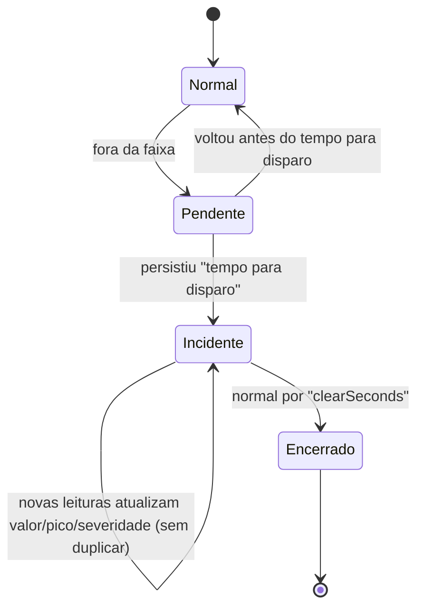

# Backend (Java 21 · Spring Boot 3.5 · Maven)

## Executar

```bash
cd backend
mvn spring-boot:run                                   # modo fiware + PostgreSQL (variáveis do ambiente)
SPRING_PROFILES_ACTIVE=local mvn spring-boot:run      # H2 em arquivo (./data), sem PostgreSQL
WINEGUARD_MODE=standalone SPRING_PROFILES_ACTIVE=local mvn spring-boot:run   # sem FIWARE
mvn test
```

Swagger UI: `http://localhost:8080/swagger-ui.html`

## Variáveis de ambiente

| Variável | Padrão | Descrição |
|---|---|---|
| `SERVER_PORT` | 8080 | porta HTTP |
| `DATABASE_URL` | `jdbc:postgresql://localhost:5432/wineguard` | JDBC do PostgreSQL |
| `DATABASE_USERNAME` / `DATABASE_PASSWORD` | `wineguard` / — | credenciais |
| `WINEGUARD_MODE` | `fiware` | `fiware` ou `standalone` |
| `CORS_ALLOWED_ORIGINS` | `http://localhost:5173` | origens liberadas (separadas por vírgula) |
| `SEED_DEVICES` | `true` | cria 1 dispositivo por área se o banco estiver vazio |
| `TELEMETRY_POLL_INTERVAL_MS` | 2000 | ciclo de monitoramento |
| `ACTUATION_RESYNC_SECONDS` | 20 | reenvio de comandos se o ESP32 reportar estado divergente |
| `SIMULATOR_PUBLISH_INTERVAL_MS` | 5000 | intervalo dos dispositivos virtuais |
| `FIWARE_*`, `MQTT_*` | — | ver [fiware.md](fiware.md) |

## Endpoints REST

| Método | Caminho | Descrição |
|---|---|---|
| GET | `/api/dashboard` | contadores, Wine Score geral, mapa, dispositivos, incidentes ativos, eventos |
| GET | `/api/system/status` | saúde de Orion / IoT Agent / STH, ciclo, provisionamento, simulador |
| POST | `/api/system/provisioning/retry` | refaz service group + subscription + provisionamento |
| GET | `/api/events?limit=` | linha do tempo |
| GET | `/api/devices` | lista com status e leituras em tempo real |
| GET | `/api/devices/{id}` | detalhe (inclui breakdown do Wine Score) |
| POST | `/api/devices` | cadastra e provisiona no IoT Agent |
| PUT | `/api/devices/{id}` | edita (o `deviceKey` é imutável) |
| PATCH | `/api/devices/{id}/status` | `{"status":"ACTIVE"\|"INACTIVE"}` |
| DELETE | `/api/devices/{id}` | exclui (remove do IoT Agent e do Orion) |
| POST | `/api/devices/{id}/provision` | reprovisiona |
| POST | `/api/devices/{id}/commands` | `{"command":"ledOn","param":""}` |
| GET | `/api/devices/{id}/history?variable=temperature&period=24h` | histórico STH-Comet + limites |
| GET | `/api/devices/{id}/events` | eventos do dispositivo |
| POST | `/api/devices/{id}/simulation/connection?paused=true` | dispositivo virtual: simula queda |
| GET | `/api/incidents?status=open&deviceId=&severity=&type=&from=&page=&size=` | central de incidentes |
| GET | `/api/incidents/{id}` | detalhe |
| POST | `/api/incidents/{id}/acknowledge` | silencia o buzzer (LED segue até normalizar) |
| GET / PUT | `/api/config/environment` | triggers, severidades, atuadores, heartbeat |
| GET | `/api/demo` | estado do Modo Demo (11 passos) |
| POST | `/api/demo/start` | `{"deviceId":2,"scenario":"TEMPERATURE","holdSeconds":20}` |
| POST | `/api/demo/recover` · `/api/demo/stop` | normalizar agora / encerrar |
| DELETE | `/api/demo/data` | apaga incidentes de demo já encerrados |

Erros seguem RFC 7807 (`application/problem+json`) com `title`, `detail` e, em validação, `errors` por campo. Falhas do FIWARE retornam **502** com o componente envolvido.

## Regras de negócio

### Triggers e incidentes

Máquina de estados por (dispositivo, variável) em [`TriggerEvaluator`](../backend/src/main/java/com/wineguard/monitoring/TriggerEvaluator.java):



### Níveis de alerta

| Nível | Regra (desvio além do limite) | Padrão T / UR / Luz |
|---|---|---|
| 🟢 NORMAL | dentro da faixa | — |
| 🟡 ATENÇÃO | desvio < crítico (ou fora da faixa aguardando disparo) | < 2 °C / 5 pp / 10 pp |
| 🟠 CRÍTICO | crítico ≤ desvio < emergência | 2–5 °C / 5–15 pp / 10–30 pp |
| 🔴 EMERGÊNCIA | desvio ≥ emergência **ou** crítico por mais de `escalationMinutes` | ≥ 5 °C / 15 pp / 30 pp ou 10 min |

### Atuação remota

[`AlertActuationService`](../backend/src/main/java/com/wineguard/monitoring/AlertActuationService.java):

- LED: `ledOn` quando existe incidente ambiental aberto; `ledOff` quando todos encerram.
- Buzzer: `alertTemp` / `alertHum` / `alertLux` por variável com incidente **ATIVO**; `alertStop|<var>` quando a variável normaliza ou é reconhecida; `alertStop|all` quando não resta nenhum.
- Comandos só são enviados quando o estado desejado muda; se o firmware reportar estado diferente por mais de 20s, o backend reenvia.

### Heartbeat

| Status | Regra (padrão) |
|---|---|
| 🟢 Online | último contato ≤ 20s |
| 🟡 Instável | 20s < último contato ≤ 60s |
| 🔴 Alerta | online com incidente ambiental aberto |
| ⚫ Offline | último contato > 60s → abre incidente "Dispositivo offline"; resolve quando volta |

### Wine Score

Ver [wine-score.md](wine-score.md).
